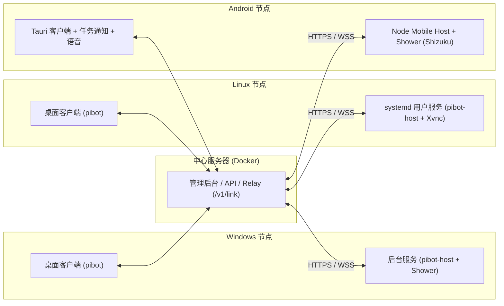

<p align="center">
  <a href="assets/logo.png"></a>
</p>

<h1 align="center">PiBot</h1>

<p align="center">
  <strong>自托管的多端 AI 助手与 Agent 协同平台（Windows · Linux · Android）</strong>
</p>

<p align="center">
  <a href="LICENSE"></a>
  <a href="https://github.com/FireSpoonYZ/PiBot/releases/latest"></a>
  <a href="https://linux.do"></a>
</p>

---

## 简介

**PiBot** 采用「**中心管控 + 设备本地执行**」架构。

- **中心服务器（Center）**通过 Docker 自托管，集中管理模型服务商与 API 凭据、设备与 Bot、MCP / Skill / 插件、Bot 学习、Webhook 自动任务以及客户端版本分发。
- **多端节点（Host & Client）**运行在 Windows、Linux 与 Android 设备上。工具在 Bot 所在设备执行，工作目录与会话主存储也在该设备。客户端通过中心的 Relay 与远端 Host 协作，Bot 学习会将会话快照传给中心处理。



### 核心特性

- **本地工具与隐私边界。** 每台设备的 Bot 绑定本地真实工作目录，内置固定版本的 `rg` / `fd` 搜索与运行时环境，设备令牌和模型凭据由系统加密存储或私有权限文件保护。
- **后台常驻执行。** 桌面端关闭窗口不中断已受理任务（Linux 基于 `systemd --user` + `linger`，Windows 基于受保护的登录自启动任务）。Android 在独立进程运行 UI，由前台服务托管 Node Mobile 子进程。
- **Bot 看板与跨机群聊。** 桌面与移动端共用「Bot 看板」，汇总所有设备的*需要你（问卷/失败）*、*工作中*、*待查看*与*空闲*状态。支持跨设备 Room 群聊协同与 Bot 私聊审阅。
- **Shower 虚拟屏。** 按会话提供独立虚拟显示空间与 GUI 自动化能力（Linux 私有 Xvnc + 轻量桌面，Windows 交互会话桌面，Android 基于 Shizuku 的虚拟屏）。
- **Bot 学习与 Webhook**。后台自动回顾会话并生成 Skill 建议。通用 JSON Webhook 支持幂等键，可用于 n8n、CI 或外部自动化脚本。

---

## 首次部署并跑通一个 Bot

在 Linux 服务器准备 Docker Engine 和 Compose v2。给中心选一个所有设备都能访问的 HTTPS 根地址，例如 `https://center.example.com`。使用自带 Caddy 时，先将域名指向服务器，并开放 TCP 80 和 443 端口。

### 1. 启动中心

从同一版本的发行页下载 `compose.yaml`、`compose.https.yaml`、`Caddyfile` 和 `center.env.example`，放在服务器的同一个目录。 [GitHub Releases](https://github.com/FireSpoonYZ/PiBot/releases/latest)

Compose 默认拉取中心的 `latest` 镜像。部署指定发行版时，将 `compose.yaml` 中的 `image` 标签改为同一个版本号，例如 `0.0.7`。

```sh
umask 077
cp center.env.example center.env
# 编辑 center.env，将 CENTER_PUBLIC_URL 设为实际 HTTPS 根地址。
docker compose -f compose.yaml -f compose.https.yaml up -d
docker compose -f compose.yaml -f compose.https.yaml ps
```

已有 HTTPS 反向代理时，使用 `docker compose up -d`，将全部路径转发到 `127.0.0.1:8080`，并为 `/v1/link` 传递 WebSocket Upgrade、为 SSE 关闭代理缓冲。 [Nginx 示例](docs/center-linux-deployment.md#反向代理)

### 2. 初始化中心

用下面的命令检查公开入口。首次部署返回 `{"status":"setup"}` 时，从服务器本机运行 `docker compose logs --tail=50 center` 读取一次性初始化码。在浏览器打开中心 HTTPS 地址，输入初始化码并设置至少 12 个字符的所有者密码。检查返回 `{"status":"ready"}` 后可登录。

```sh
curl -fsS --max-time 10 https://center.example.com/api/health
```

将示例域名换成实际地址。中心使用数据卷保存初始化配置、数据库和制品。 [初始化与数据保护](docs/center-linux-deployment.md#首次初始化)

### 3. 安装客户端并配对

从与中心匹配的发行版选对应安装包。 [GitHub Releases](https://github.com/FireSpoonYZ/PiBot/releases/latest)

| 平台 | 安装包 | 安装方式 |
| --- | --- | --- |
| Windows x64 | `PiBot-<version>-windows-x64-setup.exe` | 运行 NSIS 安装器，按系统提示授权。默认目录为 `C:\Program Files\pibot\` |
| Linux amd64 | `PiBot-<version>-linux-amd64.deb` | 在支持包内依赖且使用 systemd 的 Debian/Ubuntu 环境，运行 `sudo apt install ./PiBot-*-linux-amd64.deb`。目录中应只有一个匹配的包 |
| Android 13+（ARM64） | `PiBot-<version>-android-arm64.apk` | 在手机上安装，或在已授权设备上用 `adb install -r "./PiBot-<version>-android-arm64.apk"` 覆盖同签名应用，命令中填实际版本号 |

打开 PiBot，输入中心 HTTPS 地址与所有者密码，选择「配对并连接」。Windows 在配对后使用登录任务，Linux 使用 systemd 用户服务，Android 使用前台服务。配对完成后，在中心的「设备与 Bot」检查目标设备在线。 [桌面生命周期](desktop/README.md#首次连接) · [Android 生命周期](mobile/README.md#当前聊天与连接行为2026-10-29)

### 4. 配置模型并验证首轮

1. 登录中心，打开「服务商与模型」。编辑预置服务商或新增服务商，填写凭据并启用服务商，再在「模型管理」确认目标模型已启用。
2. 在「设备与 Bot → 修改全局模型」选默认模型。也可给目标 Bot 单独选择模型。在设备卡片确认最新配置已应用。
3. 在客户端打开一个 Bot，发送「请只回复 PIBOT_OK」。收到完整回复即验证了客户端、目标 Host、配置与模型的首轮链路。若某步失败，按层定位。 [故障定位](docs/center-linux-deployment.md#按层定位故障)

Shower 是独立的图形能力。Android 在 Shizuku 管理器启动服务后，到 PiBot「设置 → 通知与后台运行 → Shizuku」授权。 [平台前置与排查](docs/shower-cross-platform.md)

<details>
<summary>使用本地 AI Agent 辅助部署</summary>

```text
请按 PiBot README 的「首次部署并跑通一个 Bot」部署。开始前确认 Linux 服务器位置、中心 HTTPS 地址和反代方式。
在服务器准备同版本 Compose 资产并启动中心，在本机安装对应客户端。到初始化、配对和模型凭据步骤时请让我在界面里输入。
最后根据部署文档检查 HTTP、Relay、Host 服务、配置回执和第一轮聊天，告诉我通过到哪一层。
```

</details>

<details>
<summary>附：旧版 Android 覆盖升级后的系统导航栏恢复说明</summary>

仅当从早期桌面版升级且存在 `gestures.pending_restore=true` 标记时，应用会在启动时尝试将 `Settings.Global.force_fsg_nav_bar` 恢复为 `0`。若权限不足，可在设置页使用救援入口或通过 ADB 恢复：

```powershell
$adb = "$env:LOCALAPPDATA\Android\Sdk\platform-tools\adb.exe"
$serial = '<已授权设备序列号>'
& $adb -s $serial shell pm grant com.example.launcherprobe android.permission.WRITE_SECURE_SETTINGS
& $adb -s $serial shell settings put global force_fsg_nav_bar 0
& $adb -s $serial shell settings get global force_fsg_nav_bar
& $adb -s $serial shell am start -a android.settings.SETTINGS
```
</details>

---

## 文档导航

| 主题 | 文档链接 | 说明 |
| --- | --- | --- |
| **中心服务器部署** | [docs/center-linux-deployment.md](docs/center-linux-deployment.md) | Docker Compose、Nginx 反代配置、数据备份与版本升级 |
| **桌面客户端** | [desktop/README.md](desktop/README.md) | Windows / Linux 客户端架构、服务生命周期、数据目录与自动更新 |
| **Android 客户端** | [mobile/README.md](mobile/README.md) | Android 双进程架构、原生桥、远端设备控制、语音与构建细节 |
| **Bot 管理与自学习** | [docs/bot-management-learning.md](docs/bot-management-learning.md) | 模型分配、受管 Skill / MCP / 插件与后台学习 |
| **Webhook 自动任务** | [docs/webhooks.md](docs/webhooks.md) | Bearer 入口创建、幂等键要求、n8n / curl 触发示例与事件生命周期 |
| **Shower 虚拟屏** | [docs/shower-cross-platform.md](docs/shower-cross-platform.md) | Windows / Linux / Android 跨平台虚拟屏原理与权限配置 |
| **发布与版本管理** | [docs/releasing.md](docs/releasing.md) | 版本校验、签名配置、CI 发布流水线与中心客户端分发元数据 |

---

## 目录结构与源码构建

### 目录职责

| 目录 | 职责 |
| --- | --- |
| [`center-server/`](center-server/)、[`center-web/`](center-web/)、[`center-contract/`](center-contract/) | 中心服务端、管理后台前端与共享协议契约 |
| [`host-core/`](host-core/) | 多端通用 Host 核心、客户端 Broker、工具集、受管能力与固定 Pi SDK 集成 |
| [`desktop/`](desktop/) | Windows / Linux Tauri 桌面客户端、`pibot-host` 启动器与 NSIS / DEB 安装包钩子 |
| [`mobile/`](mobile/)、[`web/src/`](web/src/) | Android Tauri 外壳与多端共享 React / TypeScript 界面 |
| [`app/src/main/`](app/src/main/)、[`shower-server/`](shower-server/) | Android 原生桥接、生命周期服务、任务通知、语音与虚拟屏服务 |
| [`plugins/`](plugins/) | 内置与受管插件（如 Billion Context 等） |
| [`scripts/`](scripts/)、[`docs/`](docs/) | 构建准备脚本、发布校验工具与专题文档 |

### 从源码构建

使用与 CI 一致的 Node.js **26.13.0**。先将该版本加入 PATH，或用 `mise exec node@26.13.0 -- <命令>` 执行 Node 和 Gradle 命令。桌面与 Android 构建使用仓库固定的 Rust **1.99.1**。 [Rust 工具链](rust-toolchain.toml)

| 目标 | 构建入口 |
| --- | --- |
| 中心镜像 | 在仓库根运行 `sh scripts/center-build.sh`，得到 `pibot-center:local`。 [部署本地镜像](docs/center-linux-deployment.md#从源码构建中心镜像) |
| 仅中心前端 | `npm ci --prefix center-web`，随后运行 `npm run center:build`，产物在 `center-web/dist/` |
| 桌面 NSIS / DEB | `npm ci` 和 `npm ci --prefix host-core`，随后运行 `npm run desktop:build -- --bundles nsis` 或 `npm run desktop:build -- --bundles deb`。请先安装对应平台的编译依赖。 [桌面构建](desktop/README.md#构建) |
| Android APK | 准备 JDK 21、Android Platform 36、NDK、CMake 和 Rust target，安装 npm 依赖并运行 Node Mobile 准备脚本，再执行 `:app:assembleDebug`。 [Android 完整构建命令](mobile/README.md#构建与先决条件) |

桌面包位于 `desktop/build/target/release/bundle/`。Android 调试包位于 `app/build/outputs/apk/debug/app-debug.apk`。 [按改动范围选择验证](AGENTS.md#按变更范围选择验证)

---

## 许可证与社区

本项目基于 [AGPL-3.0](LICENSE) 许可证开源。Operit Shower 的 LGPL 派生源码及随包分发的第三方组件许可声明见 [THIRD_PARTY_NOTICES.md](THIRD_PARTY_NOTICES.md) 与 [`licenses/`](licenses/)。

欢迎访问 [LINUX DO](https://linux.do) 社区参与交流与反馈。
