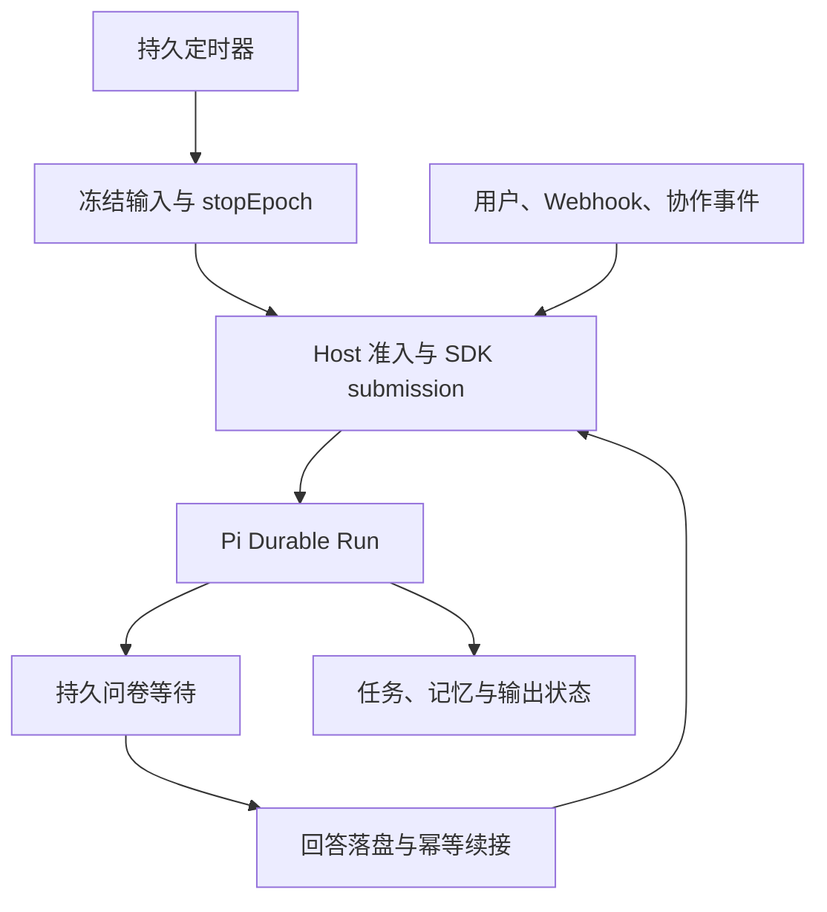

# Always-on Runtime：身份、交接与持久等待

本次重构让每轮执行有可追踪的输入，让 Host 和 Android 的定时交接可恢复，让符合条件的主聊天问卷在等待期间释放 Bot，并限制任务上下文的大小。它基于 `refactor/always-on-runtime-20261115`，在接入新版 `develop` 时保留了 Center 任务派发、Google Workspace 数据隔离、Antigravity 输入归属和 Bot Browser 客户端租约各自的边界。见 [验收记录](always-on-runtime-validation.md)。

## 文章与 PiBot 的对应关系

William Hu 于 2026-11-13 发布的 [Building always-on agents](https://claude.com/resources/articles/building-always-on-agents)
把持续在线体验解释为一连串由事件唤醒的有限运行。每轮在 Session 中工作，保存状态后休眠；用户稍后的回答也作为新事件继续工作。文章提出事件收件箱、定时器、记忆、权限、发件箱五个基础组件。

PiBot 已有这些组件的大部分基础。本次采用下表中的归属，继续由 Pi Durable 管理模型运行、工具执行和原生恢复。

| 组件 | PiBot 的事实来源 | 本次调整 |
| --- | --- | --- |
| 事件收件箱 | `TurnQueue`、SDK submission、scope `MessageLog`、Center Webhook/任务派发 | 统一投影输入身份与运行身份；沿用 Bot 准入和幂等请求 |
| 定时器 | Host 或 Android 的 `schedules.sqlite` | 持久化一次到期事件向 Runtime 交接的输入与停止代次 |
| 记忆与任务进度 | SOUL、Hindsight、Center GlobalTask、会话历史 | 任务提示改为有焦点、有上限的视图，完整事实继续按需查询 |
| 权限与等待 | Center 能力策略、TurnPin、Vault、问卷插件 | 符合条件的主聊天问卷独立等待，回答通过原准入路径恢复；频道工作和任务派发保留各自的授权与结算 |
| 发件箱 | 现有跨 Host 消息账本、发送及 ACK 流程 | 保持送达与执行状态分离；用户通知节流留待后续 |

文章建议按工作选择新建或恢复 Session。PiBot 此次继续使用每 Bot 一个统一主 Session，以保留现有聊天与协作归属；通过 Run 身份、可信路由和上下文投影缩小每轮关注范围。它没有实现按任务自动拆分 Session。



## 身份与状态的归属

| 概念 | 身份或权威 | 生命周期与含义 |
| --- | --- | --- |
| Bot | `deviceId + botId` | 能力、准入和停止边界 |
| Conversation | 主会话 UUID 与 SDK 数字 ID 的映射 | 保存多轮消息及工具历史 |
| Event | `eventId`、`requestId`、可选原生 `submissionId` | 一次输入的去重和关联；一个 Run 可以消费多个输入 |
| Run | SDK `LiveRun.first` 对应的逻辑锚点 | 跨 generation handoff 保持身份；SDK continue 可沿用同一锚点 |
| SDK execution | `nativeTaskId`、`sdkExecutionId` | 当前 generation/attempt；handoff 后可能变化 |
| GlobalTask / Step | Center 的 `taskId`、`stepId`、执行版本 | 长期业务进度；仅由可信派发上下文绑定 |
| Wait | `botId + installationId + conversationId + requestId` | 问卷与回答；独立于已经结束的工具任务 |
| Delivery | 原消息与送达回执 | 已存储或 ACK 只说明交付进度 |

`runtime-execution-context.js` 提供纯投影函数；`sessions.getRunContext(api, context, {dispatchContexts})` 从当前 SDK run 和其实际输入读取事实。逻辑 ID 为 `run:${JSON.stringify([deviceId, nativeConversationId, first])}`；`first` 不是正安全整数时 `runId` 留空，跨 handoff 的读取不一致则不返回上下文。所有输入的 request/submission 身份都保留；冻结轮中的旧 `taskId` 表示 SDK 任务，不能据此推断 GlobalTask。

执行投影使用 `accepted / queued / running / waiting / completed / failed / cancelled`。
原生终态回执优先于过时的等待提示；`waiting` 需要与本次请求匹配的有效等待记录。新问卷结束原生 Run 后，原生执行可以是 `completed`，而独立 Wait 仍是 `pending`。看板需同时表达“需要用户回应”和当前 Bot 的执行活动，等待本身不占用准入。

相关实现：[执行协议](../host-core/runtime-execution-context.js)、[会话来源](../host-core/runtime-bot-session.js)、[统一主会话](bot-sessions.md)。

## 定时交接与停止边界

到期 occurrence 先向 Runtime 取得停止代次，再将以下内容写入自己的持久记录，完成后才可提交：

```js
handoff: {
  version: 1,
  state: 'pending', // 收到合法受理回执后变为 accepted
  input: { requestId, text },
  stopEpoch,
  // acceptedAt: 首次受理时间
}
```

Host 与 Android 采用相同顺序：冻结交接 → 查询原回执 → 确认缺失后补投同一请求 → 持续对账。恢复时重新查询，进程内的“已查明缺失”标记不跨重启保存。

| 观察结果 | 调度器处理 |
| --- | --- |
| 有有效 `pending` 交接，回执明确缺失 | 使用冻结的 `requestId/text/stopEpoch` 补投 |
| 超时、断线、空对象、身份不匹配或畸形回执 | 保留不确定状态，继续查询 |
| 合法 `queued + submissionId:null` | 已在 Host 持久受理，标记 `accepted` |
| 合法 `unanswered/cancelled + submissionId:null` | 已有取消回执，结束交接 |
| 已 `accepted` 或已有旧版受理证据，后来查询缺失 | 继续对账，不再补投 |
| 旧版不确定提交没有冻结交接 | 只查询回执 |
| 重启时未捕获交接的错过 occurrence | 沿用 `skipped_offline` 策略 |
| 已终态记录收到迟到结果 | 保持终态 |

Node 内部查询以显式 `null` 表示缺失；Android IPC 还接受明确的 `SUBMISSION_NOT_FOUND/responded`。缺少 `submissionId` 字段不等同于显式 JSON `null`。

`getScheduleFence` 与 `submitScheduled` 只用于可信 Host/Java 调度桥，不加入公开 HTTP/control 协议。Runtime 强制 Host 来源，拒绝未来代次。用户 Stop 推进持久停止代次，旧交接仍携带旧值，`TurnQueue` 在受理事务中将其作废；恢复时不会重新捕获一个新代次来使旧任务继续运行。

这提供跨库交接的幂等恢复。外部工具的业务副作用仍依赖该工具自身的幂等能力，不能由 submission 去重推导出外部系统恰好执行一次。

相关实现：[Host 调度](../host-core/host-schedules.js)、[Android 调度](../app/src/main/java/com/example/launcherprobe/BotHostSchedules.java)、[Runtime 准入](../host-core/runtime-turns.js)。

## 持久问卷与续接

独立等待只用于主聊天：原轮必须回复主聊天，且不属于群聊、Bot 私聊、频道工作决策或 Center 任务派发。新 Wait 把问题、展示内容、原始冻结轮和停止代次保存到 session 作用域的 `host.durable-wait` 文档；`host.durable-wait-index` 保存每 Bot 的活动索引。索引最多容纳 64 个等待及未结算续轮；已受理的续轮直到原生回执终结才退出索引。

只有作为同一模型轮中唯一的直接工具调用，问卷才用 SDK 的 `control.terminate` 释放原 Run。频道工作、多工具轮和嵌套 codemode 调用保留既有工具内等待协议，不承诺在等待期间释放 Bot。全局任务应使用 Center 的 `ask_clarification` 和 `answer_prompt`，由 Center 按最新任务、步骤归属与执行版本重新派发。旧实验版遗留的频道/任务独立 Wait 不自动恢复。

| Wait 状态 | 含义与后续行为 |
| --- | --- |
| `pending` | 等待首次有效回答；卡片可答 |
| `answered` | 回答已持久化；冻结续接输入，等待受理或已受理 |
| `cancelled`, `reason:user` | 用户拒答；仍投递拒答结果，让模型知晓 |
| `cancelled`, `reason:stopped` | Bot 停止、清理或历史切换；关闭等待并取消对应续轮 |

续接另有 `pending / accepted / cancelling / cancelled` 状态。回答动作先提交结果及不可变文本，再查询续接回执；仅尚未受理且明确缺失时用固定续接 requestId、原 stopEpoch 和原 replyTarget 补投。首个有效答案胜出，重复点击不会重复启动新工作。`accepted` 后查询缺失只继续对账；`receiptStatus/finishedAt` 是 SDK 回执的观察结果，不形成第二套执行权威。

取消先持久写入 `cancelling`，精确取消对应 requestId 后才退出活动索引。进程退出或取消回执丢失时，冷启动的 `recoverCancellations()` 在 Harness 恢复和队列准入之前完成取消；失败阻止恢复，离线及归档 Bot 也执行这一步。TurnQueue 在入队事务和最终 SDK 提交事务中都校验 Wait，防止已经排队的旧续轮越过取消。

`/clear` 把旧会话 Wait 失效、`pi.reset` 与历史水位放在同一事务；编辑历史同样在切换原生会话映射时一并撤销旧 Wait。事务失败不会丢掉待答项；提交后继续对账精确取消。归档和删除也清理所属 Bot 的等待。频道工作不借用独立 Wait 续接，仍使用现有频道停止和结算逻辑。

UI 的可答性由 Host 查询 Wait 并核对真实工具 taskId 后投影。历史工具结果本身不拥有可答权限；原工具任务已经结束也不能单独证明问卷已处理。Host 覆盖当前 details，并只对有效待答记录在工具/工具结果顶层标记 `durableWait`，不采信 details 中的自声明。Live 的 `durableWaits` 提供至多 64 个完整活动身份，使窗口外的问卷仍可答；回答或停止后从集合移除，缓存卡立即只读。新用户消息可在同一 Bot 上继续执行，等待提示不遮蔽新的运行；Bot 忙闲仍由 SDK 执行状态决定。

超过 256 KiB、使用字节偏移分块的巨大历史条目保留不可变序列化，避免回答时改写后续 chunk 偏移。标准问卷 presentation 的上限为 48 KiB；窗口外卡片的完整最终答案在下次读取历史时补齐。

旧版 `e-launcher.ask-user-question` 的 task 作用域记录继续走原等待和回答协议。codemode-only 模式仍可直接调用问卷；嵌套问卷继续按工具内等待处理。

相关实现：[等待服务](../host-core/runtime-waits.js)、[问卷插件](../plugins/ask-user-question/entry.js)、[Live 投影](../host-core/runtime-live-projection.js)。具体接线与测试结果以验收记录为准。

## 每轮上下文

`tasks` section 以 Host 的 `getExecutionContext(botId, conversationId)` 确定本轮任务焦点。Section 可能早于 `beforeRequest` 渲染，因此焦点从当前 live run 的可信输入解析；无法确认时展示有限概况。聊天文本与上一轮残留 `activeTurn` 都不能单独提供焦点或授权。

[任务上下文投影](../plugins/tasks/context-projection.js) 的上限是 **12,000 个 UTF-16 code units**，不是 token 配额。核心协作纪律完整保留，按以下顺序分配空间：本轮任务及待确认门槛、当前步骤、目标与近期结果、有限步骤、其他任务摘要、Bot 目录。数量上限分别为焦点步骤 8 个、近期结果 2 个、其他任务 8 个、目录 Bot 6 个；字符预算还可能进一步减少数量。

省略数量明确展示，截断保持 Unicode 完整。角色权限取自 Center 的协调人和步骤归属，省略不会改变批准、依赖或完成状态；执行前仍可用 `task get/list` 读取完整事实。原始历史和 Center 数据不被裁剪。SDK 自动压缩及现有 RequestContext 最终预算守卫继续工作。

## 升级与回滚

1. 升级前停止 Host，并备份完整数据目录，包括 Durable、调度和消息数据库；SQLite 备份应包含一致的 WAL 状态。建议先升级 Center 和客户端，再升级 Host。远端链路通过 WebSocket 握手协商 Live 扩展：任一端不支持时，普通聊天仍可用，独立问卷在该链路上只读；可以从支持扩展的客户端或 Host 本机回答。代理需要保留 `X-PiBot-Live-Extensions` 请求与响应头。
2. 新版首次恢复先处理未完成的取消，再恢复 TurnPin 与等待交接。观察遗留问卷、定时 occurrence 和消息归属，不手动改写 requestId、受理证据或停止代次。
3. 问卷和 Tasks 插件均为 `1.1.0`。新 Center 会初始化当前内置版本；已部署的 Center 不会覆盖既有安装或恢复已卸载插件。为已有安装运行 `npm run center:prepare`（或从新版 Center 的构建产物取包），在浏览器的 **Center 管理 → 能力/工具 → 对应插件 → 更新、部署状态与卸载**，分别选择 `build/builtin-plugins/ask-user-question.tgz`、`build/builtin-plugins/tasks.tgz`，点击 **上传并原地更新**。这会保留安装 ID、全局启停和每个 Bot 的绑定。等目标 Host 应用部署后再验证问卷和任务上下文。
4. 降级前，在新版回答或停止仍待处理的独立问卷并核对回执。旧 Host 不能恢复新 Wait，直接替换程序不会使待答任务完成。若必须恢复备份，连同对应版本一起恢复，并核对备份之后的消息交付及外部副作用；数据库回滚不会撤销外部动作。

本分支的提交、文档和自动测试不代表已经部署或完成 Android 真机验收。

## 后续范围

频道工作与 Center 派发的独立等待需要由其各自的调度器签发新决策；不能重用已经完成的工作资格。用户通知策略、按业务任务拆分 Session、统一运行预算，以及常驻 worker 和跨 Host 接管也不在本次范围内。跨设备执行仍受设备在线状态、Center 门禁与既有权限约束。
