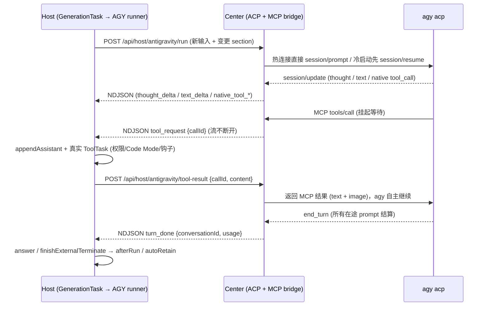

# Center Antigravity (`agy`) ACP 接入说明

Center 可选接入 Google Antigravity CLI（`agy acp`）作为服务端统一模型 Provider（Provider ID 为 `antigravity-acp`，模型 API 为 `pibot-antigravity-acp`）。该能力默认未启用，不影响普通 Center 部署或其他模型服务商；未启用时用户也无需配置 `agy`。

## 原生整轮架构

Antigravity 会话由 `agy acp` 原生持有对话上下文与轮内多步推理循环；Center 托管隔离的 `agy` 进程与本地 `pibot-bridge` MCP 服务，Host（Pi Durable）只负责界面投影和真实设备侧业务工具执行。



- **单次 `session/prompt` 跑完整轮**：每轮对话只向 `agy acp` 发起一次原生 `session/prompt`，模型在轮内通过 `pibot-bridge` MCP 自主调用 Host 工具直至 `end_turn`，流式 HTTP 通道在整轮期间保持打开。
- **Pi Durable 最小补丁（`runExternalTurn`）**：[`host-core/patch-pi-durable.js`](../host-core/patch-pi-durable.js) 仅对 `@earendil-works/pi-durable` 的 `generation.js` 施加最小补丁（`tool.js`、`submissions.js`、`live.js` 零改动）：
  - `prepare` 阶段照常渲染 section（用于计算增量），并对 AGY 跳过压缩；
  - `request` 阶段在 `beforeRequest` 之后，将 `antigravity-acp` 委托给挂在 provider 上的 `runExternalTurn`（[`host-core/antigravity-runner.js`](../host-core/antigravity-runner.js)），不进入 `streamResponse`、overflow 压缩或 Pi 侧工具轮次循环；
  - 关闭外部轮次的重启自动重试（`interrupted`）与 `classify` 自动重试，防止网络中断导致重复发送原生 prompt；
  - 问卷等触发 `control.terminate` 的场景通过独立收尾 `finishExternalTerminate` 结束本轮，不调用会创建后续 generation 的 `finishToolRound`。
- **真实 `ToolTask` 执行**：Host 收到每个 `tool_request` 后，在单事务中写入含真实 `toolCall` 的 `AssistantEntry` 并创建归属当前 generation（带 `abandonOnRestart: true`）的 `ToolTask`，完整保留设备端权限审批、Code Mode、`beforeTool`/`afterTool` 钩子、嵌套槽位与取消级联。

## Center 路由契约

契约常量与类型定义位于 [`center-contract/antigravity.js`](../center-contract/antigravity.js) 与 [`center-contract/antigravity.d.ts`](../center-contract/antigravity.d.ts)。

| 路由 | 用途 |
| --- | --- |
| `POST /api/host/antigravity/run` | 发起原生整轮推理，以 `application/x-ndjson` 流式返回 `thought_delta`、`text_delta`、`usage`、`native_tool_start`、`native_tool_end`、`tool_request`、`turn_done`、`error` 事件。 |
| `POST /api/host/antigravity/tool-result` | Host 在真实 `ToolTask` 完成后，按 `{ sessionId, runId, callId, content, isError? }` 回填工具结果（`content` 原样携带 `text` 与 `image` 块）。 |
| `POST /api/host/antigravity/steer` | 在本轮执行期间投递准入的 steer 输入，由 Center 向同一原生会话追加发出 `session/prompt`。 |
| `POST /api/host/antigravity/cancel` | 按 `{ sessionId, runId? }` 取消当前运行中的原生轮次。 |

OAuth 授权与模型目录路由保持独立且不变：`/api/providers/antigravity-acp/auth-status`、`/login`、`/login/:flowId/answer`、`/login/:flowId/cancel` 以及模型目录 `discover` / `validate`。

## 会话身份、游标与增量上下文

### 会话身份与热/冷恢复

- **身份映射链**：Host `ProviderDoc.sessionId` ↔ Center [`sessions.json`](../center-server/antigravity/sessions.ts) 中按 `(deviceId, sessionId)` 持久化的 `{ conversationId, agentName }` ↔ `agy` 原生会话库。
- **新建会话**：仅在空会话首轮或 `/clear`（轮换 `ProviderDoc.sessionId`）后调用 `session/new`，且 Center 在发出第一条 prompt 之前先落盘 `{ conversationId, agentName }`。
- **热轮复用**：原生连接仍存活且 `activeSessionId` 匹配时，直接发送 `session/prompt`，不调用 `session/load` 或 `session/resume`。
- **冷启动恢复**：进程空闲回收、Center 重启或异常退出后，下次对话通过 `session/resume` 恢复同一 `conversationId`（零历史帧重放），并经 `set_config_option` 重新设置当前 `model` 与 `thought_level`。
- **原生会话失效与旧会话升级**：若 `session/resume` 确认原生会话丢失或损坏，Center 明确返回 `AGY_HISTORY_CHANGED` 要求 `/clear`，不静默重放历史。升级后缺少新游标（`AntigravityCursorDoc`）的既有非空 AGY 会话同样一次性返回 `AGY_HISTORY_CHANGED` 要求 `/clear`。
- **运行中崩溃**：标记为 interrupted，不自动重发；下一条真实用户输入继续沿用同一原生会话。

### Host 单游标与动态 section 增量

- **单游标推进**：Host 在 Pi Durable 中仅维护一个游标文档 `AntigravityCursorDoc`（`host.antigravity-cursor`，记录 `{ sessionId, dispatchedThrough }`），并在写出 `/run` 或 `/steer` 请求**之前**推进游标。
- **本轮输入**：每轮只发送游标之后新增的用户输入条目（批量 DM、定时触发、问卷答案等按顺序及可选 `source` 发送）、本轮用户图片（ACP `image` 块，每张只发一次）以及可选的本轮路由短注（`<turn-routing>`）。不再重传旧 assistant、旧 toolResult、旧图片，也不计算任何历史或配置哈希。
- **动态 section 增量**：复用 Pi Durable 已持久化的 `SystemEntry` changed-key。首轮创建隔离 custom agent 时写入初始 SOUL（`instructions`），其余初始 section 以 `<context key="...">` 附带；后续轮次只收集游标区间内变化或移除的 section（包括后续 SOUL 变更），同 key 取最后值，以 `<context key="...">`（或 `<context key="..." removed="true" />`）发送一次，不会因修改人设、技能、工作目录或任务列表触发 `/clear`。
- **过滤在线状态抖动**：[`plugins/tasks/context-projection.js`](../plugins/tasks/context-projection.js) 过滤远端 `bot.online` 抖动，避免对端离线/重连造成每轮无意义的 `tasks` section 变化。

## 工具、图片与权限边界

- **仅 Code Mode**：顶层工具保持 `codemode` 与已启用的 model-only 工具（例如 `ask_user_question`）；普通设备工具在 `codemode` 内按需发现并执行，MCP 工具声明基本稳定。
- **连接级 MCP Token 与 run 引用校验**：每条原生 ACP 连接绑定一个本地回环 MCP token（`pibot-bridge`）。HTTP 请求进入时先同步捕获当前 active run 引用，读完请求体派发前校验仍为同一 run 引用；无 active run 时拒绝 `tools/call` 并返回普通 MCP 错误，不会毒化连接级 token。
- **150s 慢工具升级（`bridge_poll_result`）**：`agy` 的 MCP 客户端在约 180 秒后会放弃单次请求且不自动重试。当 Host 工具执行超过 `150_000ms`（150 秒）时，Center 返回含 `callId` 的 `STILL RUNNING` 提示，引导模型调用只读的 `bridge_poll_result({ callId })` 等待同一在途调用结果（可再次等待 150 秒窗口）。`bridge_poll_result` 只读结果，不重跑工具，不合成用户消息。
- **图片传递**：用户图片随当轮 prompt 以 ACP `image` 块发送；工具结果图片由 `/tool-result` 经标准 MCP `image` 块原样返回给 `agy`（含 `bridge_poll_result` 升级路径），无需额外 hook 旁路。
- **ACP 权限与原生工具**：
  - `agy` 运行在 Center 隔离环境中，ACP `session/request_permission` 请求一律自动放行（ACP 客户端自身的 `fs/*` 与 `terminal/*` 请求仍保持拒绝）。
  - 不拦截 `agy` 残留的原生工具（如 `manage_task`、`list_resources`、`read_resource`）；非 bridge 的原生工具调用仅根据 ACP `tool_call` 通知以 `native_tool_start` / `native_tool_end` 在界面展示，不创建 Pi `ToolTask`。

## 模型切换、Steer、停止与问卷

- **模型切换**：同一 Antigravity 会话内可直接切换到其他 `antigravity-acp/*` 模型（热连接通过 `set_config_option` 实时切换，冷恢复时自动重设 `model` 与 `thought_level`）。在非空会话中跨服务商切换（非 AGY ↔ AGY）会被拦截（经 Host 在线控制通道核验），需先 `/clear`。
- **Steer 与 followUp**：轮中准入的 steer 通过 `/steer` 并发发出原生 `session/prompt`，工具与输出继续流式推进；只有**最后一个在途 prompt** 结算后才发出 `turn_done` 并合并各次 prompt 的 `usage`。`followUp` 继续排队等待本轮结束。
- **停止（Stop）**：Host 中止本机在途工具 → Center 以错误结束挂起的 MCP 调用 → 向 `agy` 发送 `session/cancel` 等待终态。常规取消不杀进程、不删原生会话；仅在等待终态超时时才终止进程（同样不删会话，下一轮通过冷 `session/resume` 恢复）。
- **问卷（`ask_user_question`）**：AGY 会话下的所有问卷场景（含主聊并发与非主聊 DM/群/任务分发）统一通过 `control: { terminate: true }` 结束本轮（主聊仍创建真实 `DurableWait` pending 卡片，非主聊仅展示卡片不阻塞），MCP 向模型返回“问卷已展示，请结束本轮”，Host 经 `finishExternalTerminate` 收尾，用户提交的答案作为下一轮输入送入模型。

## AGY 会话明确禁用项

- **Hindsight `autoRecall`**：在 AGY 会话中禁用（[`plugins/hindsight/entry.js`](../plugins/hindsight/entry.js)）；保留来源登记、`autoRetain`、既有记忆 bank（`/clear` 不更换 bank）以及显式 recall / reflect / retain 工具。
- **Billion Context**：在 AGY 会话中不激活，不参与上下文准备、摘要或工具声明。
- **Pi 压缩（Compaction）**：关闭 threshold / overflow 自动压缩与手动 `/compact`（输入 `/compact` 提示改用 `/clear`）；原生上下文压缩由 `agy` 自行管理。
- **历史改写与分叉**：禁止编辑或回退已发送消息，禁止 fork 非空 AGY 会话。
- **跨服务商切换**：非空会话禁止在 AGY 与其他模型服务商之间直接互切。

## 隔离边界、安装部署与环境变量

### 隔离边界

- **中心单账号、设备侧执行工具**：`agy` 仅在 Center 进程中运行，Host 业务工具仍在已配对设备本机执行。
- **独立 Profile 隔离**：Center 专用 `--gemini-dir` 默认为 `<CENTER_DATA_ROOT>/antigravity/gemini`，专用工作目录为 `<CENTER_DATA_ROOT>/antigravity/workspace`。严禁指向宿主机日常 `~/.gemini`，不得复制或抽取个人 Google token。
- **持久化目录**：专用 home 与 `agy` 会话必须位于已有持久数据目录（Docker 为 `/data`，Linux DEB/systemd 为 `/var/lib/pibot-center`）。
- **子进程环境隔离**：Center 拉起 `agy` 子进程前会剥离 `ANTIGRAVITY_*` 环境变量。在 Windows 上，`--gemini-dir` 无法隔离系统凭据库（keyring），生产部署建议使用 Linux 容器或独立服务账号。

### 安装与部署方式

官方安装脚本 `https://antigravity.google/cli/install.sh` 仅支持 `--dir`，不支持固定版本参数。不要让容器在每次启动时自动下载或运行未固定版本的在线安装脚本。推荐以下任一部署方式：

#### 方式 1：预构建 Center 镜像 + 只读挂载宿主机 `agy`（推荐）

1. 按宿主机架构查询官方 manifest 核对版本与 SHA-512：
   - `amd64`：`https://antigravity-cli-auto-updater-974169037036.us-central1.run.app/manifests/linux_amd64.json`
   - `arm64`：`https://antigravity-cli-auto-updater-974169037036.us-central1.run.app/manifests/linux_arm64.json`
2. 下载 manifest 中的 `cli_linux_*.tar.gz`，用 `sha512sum` 校验一致后解压出 `antigravity` 二进制放到宿主机 `/usr/local/bin/agy`（权限 `0755`）。
3. 在 [`compose.yaml`](../compose.yaml) 的 `center.volumes` 中取消注释只读挂载：

```yaml
volumes:
  - center-data:/data
  - /usr/local/bin/agy:/usr/local/bin/agy:ro
```

#### 方式 2：源码构建可选内置 `agy` 的 Center 镜像

[`Dockerfile`](../Dockerfile) 提供默认关闭的可选构建参数 `INSTALL_AGY=false`。需要内置时显式传入 `INSTALL_AGY=true`（构建阶段会按固定的 `AGY_VERSION=1.5.12` 与官方 manifest URL/SHA-512 校验安装包，支持 `amd64` 与 `arm64`）：

```sh
sh scripts/center-build.sh --build-arg INSTALL_AGY=true
```

#### 方式 3：Linux DEB / systemd (`pibot-center.service`)

[`center-server/linux/pibot-center.service`](../center-server/linux/pibot-center.service) 的 `PATH` 已包含 `/usr/local/bin`，且通过 `EnvironmentFile=-/etc/pibot-center/center.env` 读取配置、`HOME` 与 `CENTER_DATA_ROOT` 均指向 `/var/lib/pibot-center`。将已校验的官方 `agy` 放至 `/usr/local/bin/agy`（或通过 `/etc/pibot-center/center.env` 指定 `PIBOT_AGY_BIN`）即可，无需修改 unit 文件。

### 环境变量与数据路径

除现有 `CENTER_*` 变量外，提供两个可选环境变量（均可在 `center.env` 或 `/etc/pibot-center/center.env` 中配置，见 [`center.env.example`](../center.env.example)）：

| 变量 | 默认值 | 说明 |
| --- | --- | --- |
| `PIBOT_AGY_BIN` | `agy` | `agy` 可执行文件名称或绝对路径 |
| `PIBOT_AGY_HOME` | `<CENTER_DATA_ROOT>/antigravity/gemini` | 可选覆盖专用 `--gemini-dir`；不得设为个人日常 `~/.gemini` |

目录结构（以默认 `CENTER_DATA_ROOT` 为例）：

- Docker 持久目录：`/data/antigravity/gemini`、`/data/antigravity/workspace`
- Linux DEB 持久目录：`/var/lib/pibot-center/antigravity/gemini`、`/var/lib/pibot-center/antigravity/workspace`

> **Center 服务进程网络代理**：`agy` 由 Center 服务进程直接拉起，不会继承其他交互终端的临时代理变量。若网络环境需要代理访问 Google 授权或模型服务，请将代理环境变量（例如 `HTTPS_PROXY` / `HTTP_PROXY` / `NO_PROXY`）直接写入 Center 的实际服务运行环境（Docker 的 `center.env` / 容器环境，或 Linux systemd 的 `/etc/pibot-center/center.env`）；只有服务进程与有效出口网络代理一致时，Center 的 `validate` 与模型刷新才能正常联通。

## 中心网页登录、既有缓存复用与启用 Provider

1. **自动识别既有登录缓存**：同一系统用户若本机已登录过 `agy`，即便使用全新 `PIBOT_AGY_HOME`，Center 启动及 `GET /api/providers/antigravity-acp/auth-status` 也会自动复用官方 CLI 登录缓存，无需强制 SSH 或重新执行终端登录。不同系统用户或独立容器则需具备各自服务用户可访问的登录缓存。
2. **中心网页授权主流程（手动登录 / 重新授权）**：
   - 在 Center 管理页「服务商与模型」中选择 **Antigravity (Center agy)**；若未检测到可用缓存或需要更换账号/重新授权，直接点击网页登录入口（调用 `POST /api/providers/antigravity-acp/login`）。
   - 在浏览器打开页面提供的 Google 官方授权链接完成同意，将跳转后的**完整回调 URL 或授权码**粘贴到网页表单提交（`POST /api/providers/antigravity-acp/login/:flowId/answer`），即可由 Center 传入 `agy --login` 完成授权；过程中也可随时点击取消（`POST /api/providers/antigravity-acp/login/:flowId/cancel`）。
   - 官方 `agy` CLI 自行掌管凭据与系统共享 keyring，Center Node 仅中转官方授权链接与用户输入、不触碰或复制 token，也不提供从网页清除系统共享 CLI keyring 的入口。
3. **自动更新目录与启用切换**：登录完成（或复用既有缓存）后，模型目录会自动同步并可直接在「服务商与模型」验证/启用；随后在「设备与 Bot」页为全局默认或指定 Bot 选择 `antigravity-acp/<modelId>` 及对应思考强度（`thinkingLevel`）。Gemini 4 Neon 和 Hydrogen 在 AGY 提供 `xhigh` 时使用原生的 Extra 档。
4. **终端命令登录（仅无浏览器环境或排查时备用）**：

   若需以服务用户直接在终端初始化或排查缓存，请以实际运行 Center 的服务用户执行（切勿用 `root` 写入持久目录导致服务用户无权读取）：

   - **Docker（服务用户 `node`）**：

```sh
docker compose exec -it -u node center agy acp --gemini-dir /data/antigravity/gemini --login
```

   - **Linux DEB / systemd（服务用户 `pibot-center`）**：

```sh
sudo -u pibot-center HOME=/var/lib/pibot-center \
  agy acp --gemini-dir /var/lib/pibot-center/antigravity/gemini --login
```

   若配置了自定义 `PIBOT_AGY_HOME`，将 `--gemini-dir` 替换为对应路径，并确保目录归属服务用户（权限 `0700`）。

## 验证与版本说明

- **自动化回归测试**：`npm test` 覆盖 Host（Pi Durable 补丁与 `runExternalTurn`）、Center 路由与 ACP/MCP 桥接的受控测试，包括原生整轮工具调用、150s 慢工具 `bridge_poll_result`、标准 MCP 图片块、同会话 AGY 模型切换、跨服务商拦截、轮中 steer、停止取消、问卷 `control.terminate` 以及旧会话升级 `/clear`。
- **Center Web-Auth 授权链路验证**：[`scripts/verify-antigravity-auth.mjs`](../scripts/verify-antigravity-auth.mjs) 使用真实 `openCenterServer` 与真实 `agy`，验证已有缓存识别（`/auth-status`）、获取官方 Google `auth_url`、无效授权码边界拒绝、取消登录以及既有缓存与目录保持可用：

```sh
node scripts/verify-antigravity-auth.mjs
```

  脚本拒绝指向日常 `~/.gemini`，且永不删除外部 `PIBOT_AGY_HOME`。
- **固定版本与运行特性**：[`Dockerfile`](../Dockerfile) 固定使用 **`agy 1.5.12`**，已实测确认 `session/resume` 零历史帧重放（恢复后需重设 `model`/`thought_level`）、标准 MCP 图片块在当轮与冷恢复后均可读、轮中 steer 由最后结算的 prompt 统一收尾、`session/cancel` 快速到达终态且不破坏会话，以及 MCP 客户端在 180 秒放弃且不自动重试（对应 150 秒升级到只读 `bridge_poll_result`）。
- **只读挂载更新提示**：`agy` 常规运行可能触发后台自更新逻辑；在只读挂载 `/usr/local/bin/agy` 的容器中二进制不可写入，需由宿主机统一更新镜像外挂载文件或重新构建镜像。
